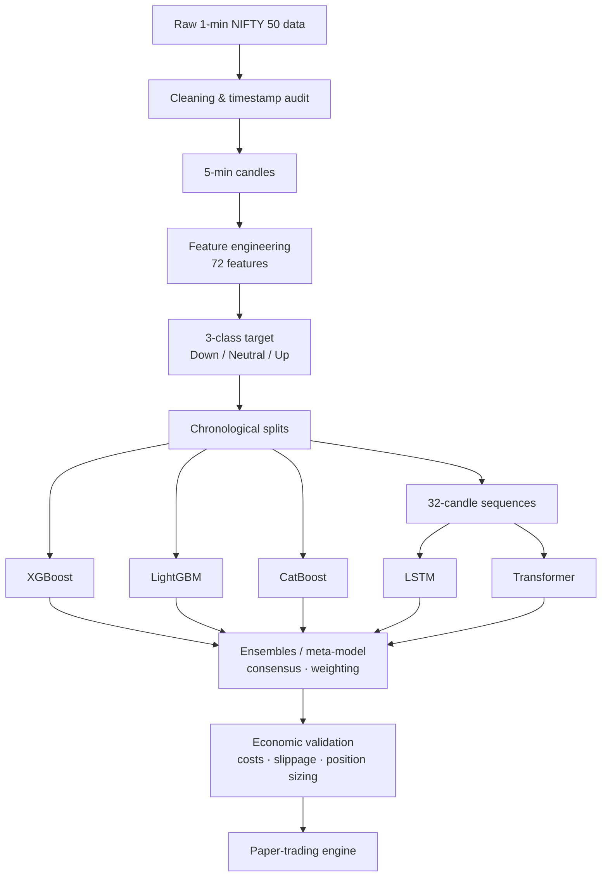

# Athena 3.0 — Intraday ML Research on NIFTY 50

> A personal learning project exploring how machine-learning and deep-learning models behave on real, noisy intraday market data.
>
> **Educational / research project only. Not financial advice. Nothing here is a recommendation to buy or sell any security.**

---

## What this project is

Athena 3.0 is a research pipeline that asks a simple question:

> *Given everything known at the close of a 5-minute candle, can a model predict whether the NIFTY 50 index will move **Down**, stay **Neutral**, or move **Up** over the next short intraday window?*

I built it to learn, end to end, what it takes to do this **honestly**: clean data, leakage-free features, strict chronological validation, multiple model families, and cost-aware evaluation, all on an ordinary laptop (4-core i5 CPU, 8 GB RAM, no GPU).

The main takeaway is that **a correct evaluation matters more than an impressive number**.

---

## Pipeline



---

## Data

| Item | Detail |
|---|---|
| Instrument | NIFTY 50 **index** |
| Raw data | Public 1-minute historical data (Kaggle), resampled to 5-minute candles |
| Period used | 2015 → March 2024 |
| Training dataset | ~91,500 rows × 72 engineered features |
| Sequence dataset | 21,605 leakage-checked windows of 32 candles × 72 features |

Market data is **not** included in this repository (size and licensing). See [`data/README.md`](data/README.md).

### Feature groups
Price structure · momentum · trend (SMA/EMA relationships) · volatility (ATR, rolling std, ranges) · breakout · session · time-of-day.

Every feature group has its own validation script in `src/athena/data/validation/`.

---

## Validation rules (applied to every model)

- ❌ No random shuffling, ever. Train always precedes test in time.
- ✅ Out-of-sample (OOS) testing year by year (2021 → 2024).
- ✅ Scalers and normalisation are fitted on **training data only**.
- ✅ Sequences never cross a trading-session boundary, and windows with intraday gaps are rejected.
- ✅ The target is attached to the decision timestamp, so no future candle is visible to a feature.
- ✅ Every model is compared against a **majority-class baseline**, not against 33%.
- ✅ Meta-models are trained only on out-of-fold, time-separated predictions.

---

## Results — five models on the same 2023 OOS window (N = 2,374)

| Model | Accuracy | Balanced acc. | vs. "always Neutral" baseline |
|---|---|---|---|
| LSTM V2 | 50.38% | 40.62% | +1.26 pp |
| CatBoost | 49.83% | 40.83% | +0.71 pp |
| Transformer V1 | 49.62% | **43.09%** | +0.50 pp |
| XGBoost | 48.90% | 40.44% | −0.22 pp |
| LightGBM | 48.65% | 40.80% | −0.47 pp |
| *Majority baseline* | *49.12%* | — | — |

**How to read this:** in 2023 every model sits within about ±1 percentage point of simply predicting "Neutral" every time. That is the honest result.

### Other findings
- **Agreement can be a signal.** On the ~60% of rows where all five models agreed, accuracy rose to **~56%**. Almost all of that came from confident *Neutral* calls; agreed *Up/Down* calls were weak.
- **Trees vs. sequences see different things.** Tree models agree with each other 83–88% of the time (probability correlation ≈ 0.95–0.98). Tree-vs-sequence agreement is lower, at 72–81%.
- **Scaling matters for neural nets.** LSTM V1 collapsed to predicting a single class (22% accuracy). The cause was unscaled features: prices around 20,000 sitting next to returns around 0.01. A train-only `StandardScaler` fixed it (V2).
- **Regime shift.** The class mix changed sharply between training years and 2023 (Neutral rose from ~27% to ~49%), and every model degraded together.

Detailed JSON reports for every experiment are in [`reports/`](reports/).

---

## Later experiments (phases 13–16)

After the model comparison I explored whether a weak edge could be turned into something tradeable:

- consensus and confidence filters
- directional inversion tests
- performance-weighted and adaptive ensembles
- cost-aware economic validation, including brokerage, STT, exchange charges, GST, stamp duty and slippage
- a trade-opportunity map
- a selective paper-trading engine and dashboard

**No strategy in this repository has been shown to be robustly profitable.** These experiments are documented as research, not as a trading system.

---

## Repository layout

```
athena-3.0/
├── docs/                  design documents & validation protocol
├── src/athena/
│   ├── data/              preprocessing + data/feature validation scripts
│   ├── features/          feature engineering
│   ├── targets/           3-class intraday target generation
│   ├── models/            xgboost / lightgbm / catboost / transformer,
│   │                      sequence (lstm), ensembles, consensus,
│   │                      confidence filter, inversion, economic validation,
│   │                      paper-trading engines
│   └── paper/             paper-trading dashboard (broker login via env vars
│                          + Windows Credential Manager, never hard-coded)
├── reports/               JSON results for every experiment
├── experiments/           experiment summaries
├── data/                  (empty — see data/README.md)
└── models/                (empty — artifacts are not committed)
```

---

## Running it

```bash
python -m venv venv
venv\Scripts\activate          # Windows
pip install -r requirements.txt
```

1. Download the NIFTY 50 1-minute data (see `test_kaggle_nifty.py`) into `data/raw/`.
2. Build the dataset: `src/athena/data/preprocessing/` (clean 1-min → 5-min → training dataset).
3. Generate the target: `src/athena/targets/generate_intraday_target.py`.
4. Train and evaluate models: scripts in `src/athena/models/<model>/`.

All scripts resolve paths relative to the repository root, so they run from any location.

---

## What I learned

1. **Beat the right baseline.** With an imbalanced 3-class target, 49% can be *worse* than doing nothing.
2. **Leakage hides everywhere:** rolling windows, scalers, sequence construction, ensemble training.
3. **Tree models don't care about scale. Neural networks care a lot.**
4. **Model diversity is measurable.** Check agreement and correlation before building an ensemble.
5. **Test the backtester itself.** A backtester that is profitable on random data is broken.

---

## Tech stack

Python 3.10 · pandas · NumPy · scikit-learn · XGBoost · LightGBM · CatBoost · TensorFlow/Keras

---

## Disclaimer

This is a personal educational project. It is **not** investment advice, a trading recommendation or a solicitation. Markets carry risk, and past or simulated performance does not indicate future results.

## Author

**Akash Kumar Singh** · personal project

## License

[MIT](LICENSE)
